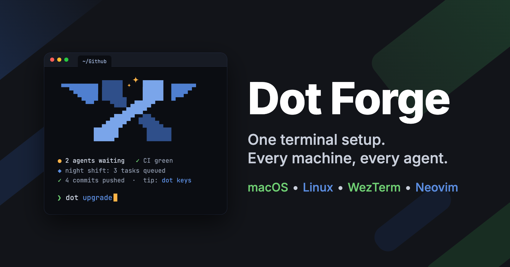

<p align="center">
  
</p>

<p align="center">
  <a href="LICENSE"></a>
  
  
  <a href="config/scripts/dot-ai"></a>
</p>

# dotfiles

Terminal setup for macOS and Linux (Ubuntu): WezTerm, Starship prompt, Neovim
(EcoVim v5), zoxide, fzf, atuin, eza, bat, delta, mise, yazi, lazygit, btop,
herdr scripts, OpenCode / agent skills, and the `ai` command.

Every AI feature runs through `config/scripts/dot-ai`: Claude Code on **your
Claude subscription login only** — API-key variables are removed and it refuses
to run if Claude Code reports any other login (`dot-ai --check`).

Day to day: `dot upgrade` (pull + upgrade tools; Neovim plugins stay pinned;
then WezTerm's sessions restart so every tab gets the new setup),
`dot save "msg"` (commit + push your config edits), `dot doctor`, `dot keys`.

## New machine

The repo is private, so log in to GitHub first.

**macOS**
```bash
xcode-select --install                     # git + compilers (wait for it to finish)
/bin/bash -c "$(curl -fsSL https://raw.githubusercontent.com/Homebrew/install/HEAD/install.sh)"
eval "$(/opt/homebrew/bin/brew shellenv)" && brew install gh
gh auth login
gh repo clone ognjenmarcheta/dotfiles ~/Github/dotfiles
~/Github/dotfiles/install.sh
```

**Linux (Ubuntu/Debian)**
```bash
sudo apt install -y git gh
gh auth login
gh repo clone ognjenmarcheta/dotfiles ~/Github/dotfiles
~/Github/dotfiles/install.sh
```

Then open a new WezTerm window and redo the logins that are deliberately not
stored here: `claude` (for `ai`), `:Copilot auth` in Neovim, and `atuin login`
if you use sync. The startup card lists whatever is still missing until it's
done (`dot hello setup`).

On a new machine the installer also asks for your git name and email (saved in
`~/.config/git/local`, not committed).

`install.sh --links-only` skips package installs and only links configs;
`--upgrade` also upgrades the tools (that's what `dot upgrade` runs).
Running it again is safe: anything it replaces goes to `~/.dotfiles-backup/<time>/`.

## How it works

| Repo                | Becomes                                   |
| ------------------- | ----------------------------------------- |
| `config/<name>`     | `~/.config/<name>` (symlink)              |
| `macos/<name>`      | `~/.config/<name>` on macOS only          |
| `config/shell/aliases.sh` | sourced from `~/.bashrc` / `~/.zshrc` |
| `config/shell/local.sh`   | per-machine extras, sourced last (not committed): `DOT_MACHINE_COLOR`, `DOT_HELLO`, `DOT_CALENDAR_ICS`… |
| `config/git/local`        | git identity / per-machine git (not committed)   |
| `config/wezterm/machine.lua` | per-machine WezTerm settings (not committed): `persistent_sessions`, `wayland`, `project_colors`, `night`, `night_hours`, `ci_repo` |

Because configs are symlinks, editing `~/.config/wezterm/config.lua` edits this
repo — commit and push to keep machines in sync.

Packages: Homebrew (`Brewfile`) on macOS; apt + official GitHub releases into
`~/.local/bin` on Linux. Both get JetBrains Mono Nerd Font, so icons work in
terminals and editors other than WezTerm too. On both, Neovim is pinned to **0.11.6** (official
release in `~/.local/opt`, linked from `~/.local/bin/nvim`) because the plugin
versions in `config/nvim/lazy-lock.json` are tested with it — Homebrew's and
newer distros' Neovim 0.12 break avante and rainbow-delimiters.

## What you get

`dot keys` prints the full cheat sheet.

- **Startup card**: every new window opens with the ByteForge anvil (drawn in
  text, not an image) and what's worth knowing: OS, uptime, battery, disk,
  RAM, Claude agents waiting, night-shift results, the CI runner, commits you
  haven't pushed. Underneath: your next meeting, setup still missing on this
  machine, yesterday's credits (first window of the day) and a 💡 tip about a
  feature you haven't used yet. The anvil takes this machine's colour (pick it
  with `DOT_MACHINE_COLOR` in `local.sh`, so Mac and Linux box look different
  over SSH), the project's colour inside a repo, glows like hot metal after
  22:00, and shows the client's logo in share mode
  (`~/.config/dotfiles/logos/acme.txt`; other projects and agents stay
  hidden). The first window of the day strikes the anvil: a few sparks, 0.3 s.
  Narrow splits get one line, scripts and agents get nothing. It takes about
  40 ms; slow numbers refresh in the background. `dot hello`, `dot fetch`
  (with sparks), `DOT_HELLO=0` off, `=compact` always one line.
- **`dot tip`**: one tip a day about a feature you haven't used — checked
  against your shell history, so it stops suggesting `dot recall` once you use
  it. `dot tip next`, `dot tip all` (✓ = used).
- **Next meeting** on the card: set `DOT_CALENDAR_ICS` in
  `~/.config/shell/local.sh` to your calendar's secret iCal link(s) or .ics
  files (comma-separated). Recurring meetings work; all-day, cancelled and
  declined ones are skipped. `dot-calendar --check` shows what it found.

- **WezTerm**: Alt+q leader (tmux-style tabs/splits): the tab bar lists what
  each next key does, it waits 4 s, Esc cancels and Alt+q twice sends Alt+q to
  the program. Clickable links, the
  same borderless window with the tab bar at the bottom on macOS and Linux,
  rounded tabs with an icon for what runs in them, cursive Victor Mono italics,
  dimmed inactive splits, a thin frame in the project's colour, frosted glass
  (macOS/KDE; `glass = true` in machine.lua elsewhere), and a cursor whose
  colour says the state (red last command failed, purple
  Claude working, green otherwise),
  Ctrl+click links inside nvim/lazygit. Ctrl+h/j/k/l
  moves between WezTerm panes *and* Neovim splits (Alt+h/j/k/l resizes);
  Leader w / W = switch / new workspace. A toast pops up when a command that
  ran 30s+ finishes while you're in another window (`DOT_NOTIFY_AFTER=0` = off).
- **Warp / kitty / Ghostty extras** (WezTerm): Shift+↑/↓ jumps between
  commands, Leader y copies the last output, triple-click selects one;
  Leader Space labels URLs / paths / hashes / IPs / issue keys to copy with two
  keystrokes; Leader p opens a project from `~/Github` as its own workspace
  (shell, nvim, lazygit tabs); Ctrl+Shift+P palette; Ctrl+Shift+U emoji picker.
  New tabs and splits open in the current folder.
- **Claude Code alerts**: a ● on the tab (and a toast if you're elsewhere)
  when Claude waits for you, ✓ when it's done — via hooks that install.sh adds
  to `~/.claude/settings.json`.
- **Sessions survive closing WezTerm**: tabs run in WezTerm's background
  session server; reopening the window brings them back (agents and dev
  servers keep running). `dot sessions` lists them, `dot sessions kill` ends
  all. Because a tab keeps the setup its shell started with, `dot upgrade`
  ends the sessions when it's done (WezTerm closes; open it again) — it asks
  first if Claude is running in a tab, and `--keep-sessions` skips it. Linux uses the regular WezTerm from its apt repository, because the
  Flatpak's sandbox can't keep anything running. Turn off per machine with
  `persistent_sessions = false` in `~/.config/wezterm/machine.lua`.
- **Project colours**: every git repo gets its own colour, shown as a stripe
  on its tabs, a badge with its name and a tinted tab bar. Pick colours in
  `machine.lua` (`project_colors = { ["kaine-forge"] = "#f5a97f" }`).
- **zsh** (default shell): grey suggestions as you type from your atuin
  history (→ accepts), syntax highlighting, fzf-tab completion menus.
  bash keeps working with the same setup.
- **History sync**: `dot sync-history` sets up atuin's end-to-end encrypted
  sync between Mac and Linux; the key goes into Bitwarden (`bw` CLI) so the
  next machine logs in without copying it by hand.
- **Standups and client updates**: `dot standup` and `dot update CLIENT` read
  your commits, branches, PRs + CI (gh), what you ran and roughly how long
  (atuin) and your `dot note`s, per repo, and Claude writes the text (copied +
  saved; `--edit`, `--hours`, `--lang sr`, `--since "nov 1"`, `--context` to see
  the raw log). Which repo belongs to which client:
  `~/.config/dotfiles/clients.toml` (`dot clients --init`; not committed).
  Repos of no client are internal: in standups, never in client updates.
- **Agents**: Leader a lists every Claude Code session (needs you / working /
  done, for how long, what about) and jumps there; Leader ? opens Claude in a
  side pane already told about the folder, git state and the last output.
- **Self-healing typos**: after a failed command with an obvious mistake, a 💡
  fix shows under the zsh prompt; Ctrl+G (or F1) puts it on the command line (never runs
  it). `DOT_FIX=0` turns it off.
- **Push-to-talk**: Alt+V, speak, any key → `ai "…"` on the command line.
  Speech-to-text is whisper.cpp on this machine; no audio leaves it.
- **Project lobby**: cd into a repo after 3+ days away → card with branch, your
  PRs, reviews waiting, CI, your last commands, and what others pushed.
- **Mood lighting and status bar**: red flash when a command fails, warmer and
  dimmer after 22:00; right side shows agents waiting, CPU/GPU °C, RAM,
  containers and whether the CI runner is up.
- **Save points**: `dot save-game NAME` / `dot load-game NAME` (or the palette)
  keep a workspace's tabs, splits, folders, running programs and branches
  across reboots; Claude panes resume with `claude --continue`.
- **New client project**: `dot new portal --client acme` creates a private repo
  from [Kaine Forge](https://github.com/ognjenmarcheta/kaine-forge), clones it to
  `~/Github/portal`, runs template adoption (`template-adoption.json`:
  product name, owner, slug, `software.byteforge.<name>`), `ai:install`,
  `ai:doctor`, `template:adopt --check`, commits without AI attribution (the
  template's commitlint rejects it), pushes, then offers `github:setup --apply`
  and the self-hosted CI runners, files the repo under the client and opens it
  as a workspace. `--local` = no GitHub, `--dry-run` = show the steps.
- **Night shift**: `dot night "api: fix the flaky export test"` queues a task;
  at 01:30 (systemd user timer / launchd) Claude Code works on it in its own
  worktree (`~/Github/.night/…`, branch `night/…` from origin's default branch)
  with your subscription login, unattended (`--permission-mode dontAsk`): it may
  edit, run the project's tools and commit, but not push or use `gh`/`curl`.
  Trailers like `Co-Authored-By: Claude` are stripped. Your first prompt in the
  morning says what's ready; `dot night report / diff / open / pr ID`. A usage
  limit pauses the queue until the next night.
- **Terminal recall**: every command's output (not full-screen apps), secrets
  masked, is kept locally for 30 days: `dot recall 5173`, `--here`, `--last 5`,
  `--ai "what port did the api say yesterday?"`, `--forget`. `DOT_RECALL=0` off.
- **Habits → shortcuts**: `dot habits` finds long commands you repeat (exact, or
  the same beginning) and offers aliases (named by Claude) or navi recipes;
  accepted ones go to `config/shell/habits.sh` (`dot save` keeps them). A hint
  shows once a week when there are new ones.
- **Screen share mode**: `dot mode share acme` before a client call: +3 font
  size, no notifications (also GNOME banners), tabs and badges of other
  projects show `•••`, red "SHARING · Acme" badge, status bar hidden, recall
  paused for other projects, and commands that print secrets (`cat .env`,
  `printenv`, `gh auth token`, `kubectl get secret`…) need a second Enter.
  `dot mode work` ends it.
- **`dot invite`**: a read-only browser link (and a QR code, copied) to a new
  shared tab, for a client or colleague to watch a deploy or a debugging
  session: tmux (its own server, no prefix key) attached read-only by ttyd on
  127.0.0.1 under a secret path, made public by a Cloudflare quick tunnel (no
  account). Share mode is on meanwhile; the link dies after `--for` (default
  1 h, max 8 h) or `dot invite stop`; `--local` = LAN / Tailscale only.
- **`dot try owner/repo`**: clones any repo (no git hooks, submodules or
  symlinks), installs its dependencies inside a container with no
  capabilities, no privilege escalation, a non-root user, CPU / memory / process
  limits and only the repo mounted, then Claude gives a tour — what it is, how
  it's organised, how to run it, and a verdict on red flags (install hooks,
  `curl | sh`, credential paths, obfuscated code) — and opens a shell inside.
  Deletes itself after 24 h (`--keep`, `--port 3000`, `list`, `shell`, `rm`).
- **`dot janitor`**: in projects untouched for 30+ days, the folders git ignores
  and that rebuild themselves (`node_modules`, `.turbo`, `.next`, `dist`,
  `target`, `.venv`…) — never tracked files, never a repo something runs in —
  plus Docker images and build cache unused for 30 days (never volumes) and
  unused pnpm / uv cache. Asks first; a weekly hint shows when 5+ GB could go.
- **`dot ports` / `dot name`**: `dot ports` lists what's listening — port,
  project and branch (worktrees marked), program, PID, clickable URL;
  `dot ports kill 5173` asks first, `dot ports open 5173`, `--json`. In a repo
  with a dev server running, `dot name` gives it `https://<repo>.localhost`
  with a certificate your browser trusts (Caddy, running in the background;
  `dot name api 8080`, `dot name rm api`, `dot name` lists). `*.localhost`
  always means this machine, so there's no DNS or `/etc/hosts` to edit; the
  first name asks once for your password to trust Caddy's certificates.
  Names are per machine (`~/.config/dotfiles/names.tsv`, not committed).
- **`dot wrapped`**: your week as a card — active time (5-minute slots with a
  command), time per project, top commands, your commits per repo, prompts to
  Claude and roughly how long agents worked, night-shift tasks, typos fixed,
  busiest day and longest command. `--since "nov 1"`, `--json`. `dot credits`
  = today so far (`--yesterday`); Fridays the card reminds you. Read from
  atuin, git and the hook log on this machine only; in share mode other
  projects show as •••.
- **`dot evolve`**: once a week the night shift reads where you struggled —
  commands that kept failing (with the error from recall), "command not
  found", repeated lookups, the same three commands you type every morning,
  slow commands, `dot doctor` warnings — and Claude improves the dotfiles in a
  worktree, runs the tests and opens a **draft PR**. Secrets are masked; client
  names and paths stay out of the code and the PR. `DOT_EVOLVE=0` turns it off.
- **Prompt**: Starship with clickable user / path segments / git branch; `↑` = `cd ..`.
- **Shell**: `ls`/`ll` via eza (icons, git status, clickable), `cat`/`man` via bat,
  `z` + Tab menu of frequent folders, Ctrl+R = atuin history, Ctrl+T / Alt+C =
  fzf file / folder, `rgf <text>` = search and open the hit in nvim, `y` = yazi.
- **`ai`**: `ai <request>` → a shell command from Claude Code (asks before
  running), `ai explain <cmd>`, `ai fix` (after a command failed — in WezTerm
  it also sends Claude the error that's on screen).
- **More tools**: `tldr`, navi (Ctrl+G, cheats in `config/navi/cheats` — adb,
  docker, kubectl, git, system), carapace completions, `just`, `fx`, `xh`.
- **git**: delta diffs (also in lazygit), zdiff3 conflicts, rerere, `git lg`,
  `git recent`, `git undo`.
- **mise**: node LTS, pnpm, uv globally; projects' `.nvmrc` / `mise.toml` win.
- **Neovim**: EcoVim v5 with pinned plugins. Mouse off, plain arrows move,
  multi-cursor on Alt+↑/↓. If plugins drift, Neovim warns — run `:PluginsRestore`.
  Avoid Lazy *Update*/*Sync*.

## CI

`.github/workflows/ci.yml` lints everything, installs from scratch into an empty
home folder, runs `tests/doctor.sh --nvim`, then checks a second run changes
nothing. It uses the self-hosted runner on the workstation (`kaine-ci-linux`,
like kaine-forge and ordina-forge) and falls back to GitHub's runners when that
is down. `macos.yml` does the same on macOS with `/bin/bash` 3.2, only when the
installer or scripts change (macOS minutes are expensive). `tests/work.sh`,
`tests/features.sh`, `tests/hello.sh`, `tests/ports.sh` and `tests/wrapped.sh` test standups, night shift, recall, habits, share mode,
`dot new`, `dot invite`, `dot try`, `dot janitor`, `dot evolve`, the startup
card, `dot tip`, `dot ports` / `dot name` and `dot wrapped` with stand-in
`claude` / `gh` / `docker`; CI also runs a real `dot invite` (ttyd: secret path
works, nothing else does) and a real `dot try` (checks from inside the sandbox:
not root, no capabilities, no Docker socket). `new-project.yml` runs `dot new --local`
against the real Kaine Forge template weekly and when `dot-new` changes.

## Not in this repo (on purpose)

Logins and tokens (`gh/hosts.yml`, Copilot, OpenCode `service.json`, container
registry auth), SSH keys, `~/.gitconfig`, and the contents of `~/.agents/skills`.

## License

Apache-2.0 — see [`LICENSE`](LICENSE) and [`NOTICE`](NOTICE). Security
reports: [`SECURITY.md`](SECURITY.md). How to change things:
[`CONTRIBUTING.md`](CONTRIBUTING.md).
