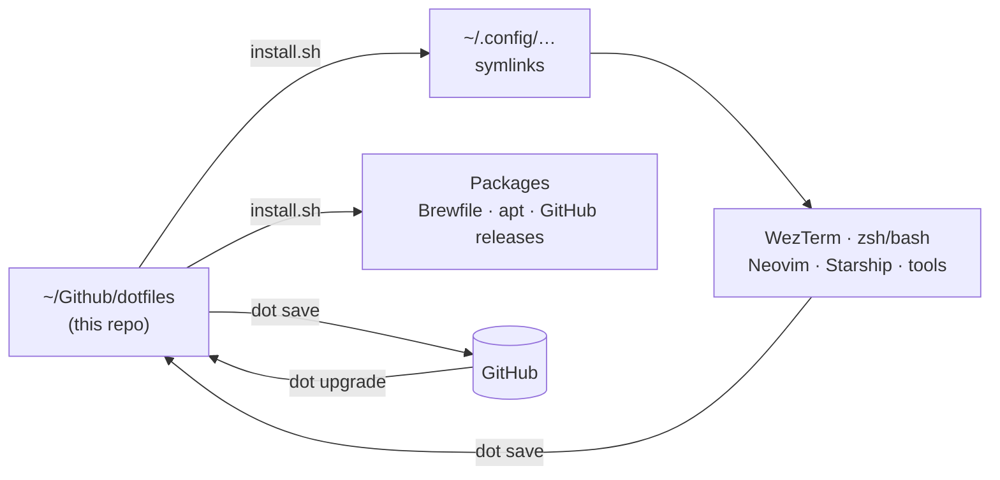

<p align="center">
  
</p>

<p align="center">
  <a href="LICENSE"></a>
  
  
  <a href="config/scripts/dot-ai"></a>
</p>

<p align="center">
  <b>One terminal setup for every machine and every agent.</b><br>
  WezTerm · zsh · Starship · Neovim (EcoVim v5) · atuin · fzf · zoxide · mise · lazygit · Claude Code
</p>

<p align="center">
  <a href="#quick-start">Quick start</a> ·
  <a href="#everyday-commands">Everyday commands</a> ·
  <a href="#keyboard">Keyboard</a> ·
  <a href="#features">Features</a> ·
  <a href="#how-it-works">How it works</a> ·
  <a href="#for-agents">For agents</a>
</p>

---

## 👋 What this is

A personal terminal setup that installs the same way on **macOS** and
**Linux (Ubuntu/Debian)**. One script links the configs and installs the
tools, and one command (`dot`) keeps them up to date.

| | |
|---|---|
| 🖥️ **Terminal** | WezTerm with a tmux-style leader key, persistent sessions, project colours and Warp-style command blocks |
| 🐚 **Shell** | zsh (bash works too): suggestions as you type, syntax highlighting, fuzzy completion, atuin history |
| 🤖 **AI** | `ai`, typo fixes, standups, agent radar, night shift. Everything goes through Claude Code on **your subscription** |
| 📝 **Editor** | Neovim 0.11.6 + EcoVim v5 with pinned plugins |
| 🧰 **`dot`** | One command to upgrade, check, save and use every feature: `dot keys` lists them all |

> [!IMPORTANT]
> **AI only ever uses your Claude subscription login.** Every AI feature runs
> through [`config/scripts/dot-ai`](config/scripts/dot-ai), which removes
> API-key variables and refuses to run if Claude Code reports any other login.
> Check with `dot-ai --check`.

---

<a id="quick-start"></a>

## 🚀 Quick start

Clone it to `~/Github/dotfiles` and run the installer. It installs everything else, including `gh`.

<details open>
<summary><b>🍎 macOS</b></summary>

```bash
xcode-select --install                     # git + compilers (wait for it to finish)
/bin/bash -c "$(curl -fsSL https://raw.githubusercontent.com/Homebrew/install/HEAD/install.sh)"
git clone https://github.com/ognjenmarcheta/dotfiles ~/Github/dotfiles
~/Github/dotfiles/install.sh
```

</details>

<details open>
<summary><b>🐧 Linux (Ubuntu / Debian)</b></summary>

```bash
sudo apt install -y git
git clone https://github.com/ognjenmarcheta/dotfiles ~/Github/dotfiles
~/Github/dotfiles/install.sh
```

</details>

**Then open a new WezTerm window and finish the logins** that are deliberately
not stored in the repo. The startup card lists whatever is still missing
(`dot hello setup`):

- [ ] `gh auth login` (PRs, CI status, `dot new`, standups)
- [ ] `claude`: log in once (needed for `ai` and every other AI feature)
- [ ] `:Copilot auth` in Neovim
- [ ] `atuin login`, only if you use history sync (`dot sync-history`)

On a new machine the installer also asks for your git name and email. They're
saved in `~/.config/git/local`, which is not committed.

> [!TIP]
> **Using it yourself?** Fork it, clone your fork, and point the few
> owner-specific defaults at your own account: `export GITHUB_USER=you` in
> `~/.zshenv` (clickable prompt links), `ci_repo` in `config/wezterm/machine.lua`
> (status bar CI), and `DOT_NEW_TEMPLATE` for `dot new`.

| Installer flag | Does |
|---|---|
| `install.sh` | Install packages and link every config. Safe to run again: anything it replaces goes to `~/.dotfiles-backup/<time>/` |
| `install.sh --links-only` | Only link configs, no package installs |
| `install.sh --upgrade` | Also upgrade the tools (this is what `dot upgrade` runs) |
| `install.sh --no-nvim` | Skip installing Neovim plugins |

---

<a id="everyday-commands"></a>

## 🧭 Everyday commands

| Command | What it does |
|---|---|
| `dot upgrade` | Pull the dotfiles and upgrade tools. Neovim plugins stay pinned. WezTerm's sessions restart afterwards so every tab gets the new setup (it asks first if Claude is running in a tab; `--keep-sessions` skips it) |
| `dot save "msg"` | Commit and push your config edits |
| `dot doctor` | Check that everything is installed and wired up |
| `dot keys` | The full cheat sheet |
| `dot help` | Every `dot` subcommand |
| `dot tip` | One feature you haven't used yet |

### ✅ Good habits

- **Edit in the repo, then `dot save`.** Configs are symlinks, so
  `~/.config/wezterm/config.lua` *is* the repo file. Commit and push to keep
  machines in sync.
- **Run `dot upgrade` regularly**, and `dot doctor` when something looks off.
- **Keep per-machine values out of committed files.** Use `config/shell/local.sh`,
  `config/git/local` or `config/wezterm/machine.lua` (see [Per-machine files](#per-machine-files)).
- **Never update Neovim plugins from Lazy** (*Update* / *Sync*). Versions are
  pinned in `lazy-lock.json`; if they drift, Neovim warns. Run `:PluginsRestore`.
- **Turn on share mode before a client call:** `dot mode share acme`, then `dot mode work` afterwards.
- **Save a workspace before a reboot:** `dot save-game NAME`, and `dot load-game NAME` to get it back.

---

<a id="keyboard"></a>

## ⌨️ Keyboard

Every shortcut works the same on a **MacBook keyboard** and a **60% keyboard**
(no F-row, no right Option). Nothing needs Fn. Where an F-key exists, it has a
non-F alternative.

**Leader = `Alt+q`, then the key.** The tab bar shows what each key does and
waits 4 s. `Esc` cancels, and `Alt+q` twice sends `Alt+q` to the program.

<table>
<tr><th>🖥️ WezTerm</th><th>🐚 Shell</th></tr>
<tr valign="top"><td>

| Keys | Action |
|---|---|
| `Leader c` / `x` | New tab / close pane |
| `Leader \|` / `-` | Split right / down |
| `Leader b` / `n` / `0-9` | Previous / next / go to tab |
| `Leader w` / `W` | Pick / new workspace |
| `Leader p` | Open a project as a workspace |
| `Leader a` | Agent radar (every Claude session) |
| `Leader ?` | Claude in a side pane, with context |
| `Leader y` | Copy the last command's output |
| `Leader Space` / `u` | Label and copy text / open a URL |
| `Ctrl+h/j/k/l` | Move between panes **and** Neovim splits |
| `Alt+h/j/k/l` | Resize panes / splits |
| `Shift+↑` / `↓` | Jump to previous / next command |
| `Ctrl+Shift+P` / `U` | Command palette / emoji picker |
| `Cmd+W` | Close tab (no "really?") |

</td><td>

| Keys | Action |
|---|---|
| `Ctrl+G` | Text on the line → **plain English becomes a command**. Empty line → take the 💡 fix, else navi |
| `→` | Accept the grey suggestion |
| `Ctrl+R` | atuin history search |
| `Tab` | Fuzzy completion with previews |
| `Ctrl+T` / `Alt+C` | Insert a file / cd into a folder |
| `Alt+←` / `→` | Jump by word (Option on a Mac) |
| `Shift+Enter` | New line instead of running |
| `Alt+V` | Push-to-talk → `ai "…"` |
| `Ctrl+_` | Undo (e.g. after `Ctrl+G`) |
| `F1` | Same as `Ctrl+G` for the 💡 fix |

**Neovim:** `Ctrl+/` (or `F12`) toggles the terminal. `Alt+↑/↓` adds a multi-cursor.

</td></tr>
</table>

---

<a id="features"></a>

## ✨ Features

Short version below. Click a group for the details.

<details>
<summary><b>🖥️ Terminal: WezTerm</b>: leader key, sessions that survive, project colours, Warp-style blocks</summary>

- **Looks:** the same borderless window on macOS and Linux with the tab bar at
  the bottom, rounded tabs with an icon for what runs in them, cursive Victor
  Mono italics, dimmed inactive splits, a thin frame in the project's colour,
  and frosted glass (macOS/KDE; `glass = true` in `machine.lua` elsewhere).
- **Cursor colour shows state:** red = last command failed, purple = Claude
  working, green otherwise.
- **Links:** clickable everywhere. Inside nvim/lazygit/btop, Ctrl+click.
- **Warp / kitty / Ghostty extras:** Shift+↑/↓ jumps between commands, Leader y
  copies the last output, triple-click selects one output. Leader Space labels
  URLs / paths / hashes / IPs / issue keys to copy with two keystrokes. New tabs
  and splits open in the current folder.
- **Sessions survive closing WezTerm:** tabs run in WezTerm's background session
  server, so agents and dev servers keep running and reopening the window brings
  them back. `dot sessions` lists them, `dot sessions kill` ends all. Linux uses
  the regular WezTerm from its apt repository, because the Flatpak's sandbox
  can't keep anything running. Turn off per machine with
  `persistent_sessions = false` in `machine.lua`.
- **Project colours:** every git repo gets its own colour as a stripe on its
  tabs, a badge with its name and a tinted tab bar. Pick your own in
  `machine.lua`: `project_colors = { ["kaine-forge"] = "#f5a97f" }`.
- **Mood lighting and status bar:** red flash when a command fails, warmer and
  dimmer after 22:00 (`night = false` to turn off). The right side shows agents
  waiting, CPU/GPU °C, RAM, containers and whether the CI runner is up.
- **Toasts:** when a command that ran 30 s+ finishes while you're in another
  window (`DOT_NOTIFY_AFTER=0` = off).
- **Save points:** `dot save-game NAME` / `dot load-game NAME` (or the palette)
  keep a workspace's tabs, splits, folders, running programs and branches across
  reboots. Claude panes resume with `claude --continue`.

</details>

<details>
<summary><b>🐚 Shell: zsh</b>: suggestions, highlighting, history, smart <code>z</code>, typo fixes</summary>

- **zsh** is the default shell: grey suggestions from your atuin history as you
  type (→ accepts), syntax highlighting, fzf-tab completion menus, and carapace
  completions for hundreds of CLIs (gh, docker, kubectl, npm…). bash keeps
  working with the same setup.
- **Prompt:** Starship with clickable user / path segments / git branch. Click `↑` to `cd ..`.
- **Tools:** `ls`/`ll`/`lt` via eza (icons, git status, clickable), `cat`/`man`
  via bat, `rgf <text>` searches and opens the hit in nvim, `y` = yazi,
  `tldr`, `just`, `fx`, `xh`, and navi cheats in `config/navi/cheats` (adb,
  docker, kubectl, git, system).
- **History sync:** `dot sync-history` sets up atuin's end-to-end encrypted sync
  between Mac and Linux. The key goes into Bitwarden (`bw` CLI), so the next
  machine logs in without copying it by hand.
- **`z` by meaning:** `z "the mandarin app"` or `z billing acme`. When zoxide
  can't match two or more words, `dot find` picks the project they describe
  from its README, description, client, top-level files and recent commits
  (worktrees too). A small embedding model runs locally (fastembed via uv,
  ~0.4 s a search). Nothing is sent anywhere, and keyword matching still works
  without it. `dot find "…"` shows matches and why.
- **Self-healing typos:** after a failed command with an obvious mistake, a 💡
  fix shows under the prompt. `Ctrl+G` on the empty line (or `F1`) puts it on
  the command line. It never runs it. `DOT_FIX=0` turns it off.
- **Terminal recall:** every command's output (not full-screen apps), secrets
  masked, is kept locally for 30 days: `dot recall 5173`, `--here`, `--last 5`,
  `--ai "what port did the api say yesterday?"`, `--forget`. `DOT_RECALL=0` = off.
- **Habits → shortcuts:** `dot habits` finds long commands you repeat and
  offers aliases (named by Claude) or navi recipes. Accepted ones go to
  `config/shell/habits.sh`.
- **Project lobby:** cd into a repo after 3+ days away → a card with branch,
  your PRs, reviews waiting, CI, your last commands and what others pushed.
- **git:** delta diffs (also in lazygit), zdiff3 conflicts, rerere, `git lg`,
  `git recent`, `git undo`.
- **mise:** node LTS, pnpm and uv globally. Projects' `.nvmrc` / `mise.toml` win.

</details>

<details>
<summary><b>🤖 AI and agents</b>: <code>ai</code>, agent radar, Claude alerts, night shift, <code>dot evolve</code></summary>

- **`ai`:** `ai <request>` → a shell command from Claude Code (asks before
  running), `ai explain <cmd>`, `ai fix` (after a failure; in WezTerm it also
  sends the error that's on screen). Or type the request on the prompt line
  and press **Ctrl+G**: the line turns into the command (nothing runs until
  Enter; `Ctrl+_` undoes).
- **Push-to-talk:** `Alt+V`, speak, any key → `ai "…"` on the command line.
  Speech-to-text is whisper.cpp on this machine, so no audio leaves it.
- **Claude Code alerts:** a ● on the tab (and a toast if you're elsewhere) when
  Claude waits for you, ✓ when it's done, through hooks that `install.sh` adds
  to `~/.claude/settings.json`.
- **Agent radar:** `Leader a` lists every Claude Code session (needs you /
  working / done, how long, what about) and jumps there. `Leader ?` opens Claude
  in a side pane, already told about the folder, git state and the last output.
- **Night shift:** `dot night "api: fix the flaky export test"` queues a task.
  At 01:30 (systemd user timer / launchd), Claude Code works on it unattended
  in its own worktree (`~/Github/.night/…`, branch `night/…` from origin's
  default branch) with your subscription login. It may edit, run the project's
  tools and commit, but not push or use `gh`/`curl`. `Co-Authored-By: Claude`
  trailers are stripped. Your first prompt in the morning says what's ready:
  `dot night report / diff / open / pr ID`. A usage limit pauses the queue until
  the next night.
- **`dot evolve`:** once a week the night shift reads where you struggled
  (failing commands, "command not found", repeated lookups, slow commands,
  `dot doctor` warnings), improves the dotfiles in a worktree, runs the tests
  and opens a **draft PR**. Secrets are masked, and client names stay out.
  `DOT_EVOLVE=0` = off.

</details>

<details>
<summary><b>💼 Work and clients</b>: standups, client updates, share mode, new projects</summary>

- **Standups and client updates:** `dot standup` and `dot update CLIENT` read
  your commits, branches, PRs + CI (gh), what you ran and roughly how long
  (atuin) and your `dot note`s, per repo. Claude writes the text, which is
  copied and saved (`--edit`, `--hours`, `--lang sr`, `--since "nov 1"`,
  `--context`). Which repo belongs to which client lives in
  `~/.config/dotfiles/clients.toml` (`dot clients --init`; not committed). Repos
  of no client are internal: they appear in standups, never in client updates.
- **Screen share mode:** `dot mode share acme` before a client call: +3 font
  size, no notifications, other projects' tabs show `•••`, a red "SHARING ·
  Acme" badge, status bar hidden, recall paused for other projects, and
  commands that print secrets (`cat .env`, `printenv`, `gh auth token`…) need a
  second Enter. `dot mode work` ends it.
- **`dot invite`:** a read-only browser link (and a QR code, copied) to a new
  shared tab, for someone to watch a deploy or a debugging session. tmux is
  attached read-only by ttyd under a secret path and made public by a
  Cloudflare quick tunnel. Share mode is on meanwhile. The link dies after
  `--for` (default 1 h, max 8 h) or `dot invite stop`; `--local` = LAN /
  Tailscale only.
- **New client project:** `dot new portal --client acme` creates a private
  repo from [Kaine Forge](https://github.com/ognjenmarcheta/kaine-forge), clones
  it to `~/Github/portal`, runs template adoption, `ai:install`, `ai:doctor`,
  `template:adopt --check`, commits and pushes, then offers `github:setup --apply`
  and the self-hosted CI runners, files the repo under the client and opens it
  as a workspace. `--local` = no GitHub, `--dry-run` = show the steps.

</details>

<details>
<summary><b>🧪 Projects, ports and cleanup</b>: <code>dot try</code>, <code>dot ports</code>, <code>dot name</code>, <code>dot janitor</code></summary>

- **`dot try owner/repo`:** clones any repo (no git hooks, submodules or
  symlinks) and installs its dependencies in a locked-down container (no
  capabilities, non-root, CPU / memory / process limits, only the repo
  mounted). Claude then gives a tour (what it is, how to run it, and red flags
  like install hooks or `curl | sh`) and opens a shell inside. It deletes itself
  after 24 h (`--keep`, `--port 3000`, `list`, `shell`, `rm`).
- **`dot ports`:** what's listening: port, project and branch, program, PID,
  clickable URL. `dot ports kill 5173` (asks first), `dot ports open 5173`, `--json`.
- **`dot name`:** gives the dev server in this repo `https://<repo>.localhost`
  with a certificate your browser trusts (Caddy in the background). `dot name api 8080`,
  `dot name rm api`, `dot name` lists. No DNS or `/etc/hosts` edits; the first
  name asks once for your password. Names are per machine
  (`~/.config/dotfiles/names.tsv`).
- **`dot janitor`:** in projects untouched for 30+ days, removes the folders
  git ignores that rebuild themselves (`node_modules`, `.next`, `dist`,
  `target`, `.venv`…), never tracked files. It also removes Docker images and
  build cache unused for 30 days (never volumes) and unused pnpm / uv cache. It
  asks first.

</details>

<details>
<summary><b>🎴 Startup card and stats</b>: the anvil, tips, next meeting, <code>dot wrapped</code></summary>

- **Startup card:** every new window opens with the ByteForge anvil (drawn in
  text) and what's worth knowing: OS, uptime, battery, disk, RAM, Claude agents
  waiting, night-shift results, the CI runner, unpushed commits, your next
  meeting, setup still missing, yesterday's credits and a 💡 tip. The anvil
  takes this machine's colour (`DOT_MACHINE_COLOR`), the project's colour in a
  repo, glows after 22:00, and shows the client's logo in share mode. It takes
  ~40 ms. Narrow splits get one line, and scripts and agents get nothing.
  `dot hello`, `dot fetch` (with sparks), `DOT_HELLO=0` = off, `=compact` = one line.
- **Next meeting:** set `DOT_CALENDAR_ICS` in `local.sh` to your calendar's
  secret iCal link(s) or .ics files (comma-separated). `dot-calendar --check`
  shows what it found.
- **`dot tip`:** one tip a day about a feature you haven't used, checked against
  your shell history. `dot tip next`, `dot tip all` (✓ = used).
- **`dot wrapped`:** your week as a card: active time, time per project, top
  commands, commits per repo, prompts to Claude, night-shift tasks, typos fixed,
  busiest day. `--since "nov 1"`, `--json`. `dot credits` = today so far
  (`--yesterday`). All read from this machine only.

</details>

<details>
<summary><b>📝 Neovim</b>: EcoVim v5, pinned</summary>

- EcoVim v5 with plugins pinned in `config/nvim/lazy-lock.json`. Mouse off,
  plain arrows move, multi-cursor on `Alt+↑/↓`, `Ctrl+/` toggles the terminal.
- Neovim itself is pinned to **0.11.6** (official release in `~/.local/opt`,
  linked from `~/.local/bin/nvim`), because the pinned plugins are tested with
  it. Neovim 0.12 breaks avante and rainbow-delimiters.
- If plugins drift, Neovim warns: run `:PluginsRestore`. Don't use Lazy *Update* / *Sync*.
- Full key list: [`config/nvim/README.md`](config/nvim/README.md).

</details>

---

<a id="how-it-works"></a>

## 🔧 How it works



| In the repo | Becomes |
|---|---|
| `config/<name>` | `~/.config/<name>` (symlink) |
| `macos/<name>` | `~/.config/<name>`, on macOS only |
| `config/shell/aliases.sh` | Sourced from `~/.bashrc` / `~/.zshrc` |
| `config/scripts/dot*` | The `dot` command and its subcommands |

Because configs are symlinks, editing `~/.config/...` edits this repo.

<a id="per-machine-files"></a>

### Per-machine files

These are never committed:

| File | For |
|---|---|
| `config/shell/local.sh` | Shell extras, sourced last: `DOT_MACHINE_COLOR`, `DOT_HELLO`, `DOT_CALENDAR_ICS`… |
| `config/git/local` | Git identity and per-machine git settings |
| `config/wezterm/machine.lua` | `persistent_sessions`, `wayland`, `project_colors`, `night`, `night_hours`, `ci_repo`, `glass` |
| `~/.config/dotfiles/clients.toml` | Which repo belongs to which client |

### Packages

- **macOS:** Homebrew ([`Brewfile`](Brewfile)).
- **Linux:** apt, plus official GitHub releases into `~/.local/bin`.
- **Both:** JetBrains Mono Nerd Font, so icons work outside WezTerm too, and
  Neovim pinned to 0.11.6.

### Not in this repo (on purpose)

Logins and tokens (`gh/hosts.yml`, Copilot, OpenCode `service.json`, container
registry auth), SSH keys, `~/.gitconfig`, and the contents of `~/.agents/skills`.

---

<a id="for-agents"></a>

## 🤖 For AI agents (and contributors)

Read this before changing anything. [`CONTRIBUTING.md`](CONTRIBUTING.md) has
the branch and PR rules.

### Repo map

```text
install.sh               installer for macOS + Linux (--links-only, --upgrade, --no-nvim)
Brewfile                 macOS packages
config/
  shell/aliases.sh       entry point for zsh + bash; sources the files below
  shell/*.sh             one feature per file (ai, fix, marks, voice, share, hello…)
  scripts/dot            the `dot` command: dispatch, `dot help`, `dot keys`
  scripts/dot-<name>     one script per subcommand (dot-night, dot-ports…)
  scripts/dot-ai         the ONLY way to call Claude (subscription login enforced)
  wezterm/config.lua     WezTerm settings and keys
  wezterm/features.lua   leader table, status bar, Warp-style extras
  wezterm/events.lua     tab titles and status updates
  nvim/                  EcoVim v5 (plugins pinned in lazy-lock.json)
macos/                   macOS-only configs (aerospace)
tests/                   lint + feature tests (stand-in claude / gh / docker)
media/                   banner and brand assets
```

### Where to make a change

| You want to… | Edit | Also update |
|---|---|---|
| Add a shell alias or function | `config/shell/aliases.sh`, or a new `config/shell/<feature>.sh` sourced from it | `tests/lint.sh` (`shell_files`) for a new file |
| Add a `dot` subcommand | `config/scripts/dot-<name>` + a case in `config/scripts/dot` | `dot help` text, `tests/lint.sh` (`bash_files`), a test in `tests/` |
| Add or change a WezTerm key | `config/wezterm/config.lua` (leader keys: `mods = "LEADER"`) | `leader_hint_keys` in `features.lua`, `tests/wezterm-config.sh` |
| Add a package | `Brewfile` (macOS) **and** `install.sh` (Linux) | `tests/doctor.sh` if it must be present |
| Call Claude | Pipe into `config/scripts/dot-ai` (`--fast` for small jobs) | Never call `claude` or an API directly |
| Change Neovim | `config/nvim/` | `config/nvim/README.md` for keys |
| Change any key or command a person uses | — | `dot keys` in `config/scripts/dot` and this README |

### Rules that must hold

1. **Works on both macOS and Linux.** Scripts must also run under macOS
   `/bin/bash` 3.2. Shell files run in **both zsh and bash**.
2. **No secrets or per-machine values in committed files.** Use the
   [per-machine files](#per-machine-files).
3. **All AI goes through `dot-ai`.** Never an API key, never a direct `claude` call.
4. **Every key works without Fn.** It must work on a MacBook and on a 60%
   keyboard. F-keys may exist, but only as alternatives.
5. **Suggestions never run by themselves.** AI-generated commands land on the
   prompt line or ask first.
6. **Don't bump Neovim or its plugins** casually. Both are pinned on purpose.
7. **Re-running `install.sh` changes nothing** on a set-up machine (CI checks this).

### Checks

```bash
bash tests/lint.sh            # syntax (bash + zsh), shellcheck, Lua: run on every change
bash tests/wezterm-config.sh  # WezTerm config loads and key bindings exist
bash tests/features.sh        # night shift, recall, habits, share mode, invite, try, janitor, evolve
bash tests/work.sh            # standups and client updates
bash tests/hello.sh           # startup card, dot tip
bash tests/ports.sh           # dot ports / dot name
bash tests/wrapped.sh         # dot wrapped
bash tests/find.sh            # z by meaning
tests/doctor.sh               # on a machine with the setup installed (--nvim for Neovim too)
```

### CI

- **`ci.yml`:** lints everything, installs from scratch into an empty home
  folder, runs `tests/doctor.sh --nvim` and the feature tests, then checks that
  a second install changes nothing. It also runs a real `dot invite` and a real
  `dot try` (checked from inside the sandbox). It uses the self-hosted runner
  `kaine-ci-linux` and falls back to GitHub's runners when that is down.
- **`macos.yml`:** the same on macOS with `/bin/bash` 3.2, only when the
  installer or scripts change.
- **`new-project.yml`:** runs `dot new --local` against the real Kaine Forge
  template weekly and when `dot-new` changes.

---

## 📄 License

A personal setup: only the owner commits, and pull requests and issues are
turned off. **Fork or clone it freely** and make it yours.

Apache-2.0. See [`LICENSE`](LICENSE) and [`NOTICE`](NOTICE).
Security reports: [`SECURITY.md`](SECURITY.md). How to change things:
[`CONTRIBUTING.md`](CONTRIBUTING.md).
